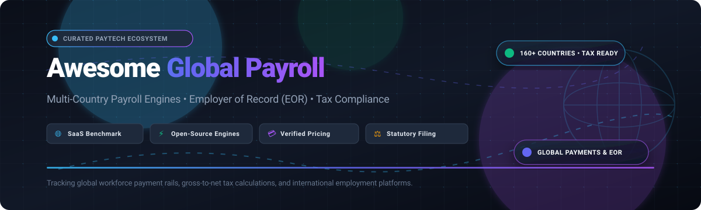

  

# 🌐 Awesome Global Payroll: Top Multi-Country Payroll Software & Open-Source Solutions

  
  
  
  
  

A curated directory and guide to enterprise **Global Payroll SaaS platforms**, Employer of Record (EOR) services, multi-country gross-to-net tax engines, and **open-source payroll calculation frameworks**. 🌍💼

Whether you manage an international workforce across dozens of jurisdictions or architect global payroll infrastructure, this list tracks leading commercial software suites, transparent pricing benchmarks, free tier terms, corporate scale, and community-driven open-source projects. 🚀

**Last updated: October 2026** 📅

---

## 📑 Table of Contents

- [📊 Sector Overview & Market Dynamics](#-sector-overview--market-dynamics)
- [🏢 Global Payroll SaaS Platforms](#-global-payroll-saas-platforms)
- [💻 Open-Source GitHub Projects](#-open-source-github-projects)
- [🎯 How to Choose a Global Payroll Solution](#-how-to-choose-a-global-payroll-solution)
- [🤝 Support](#-support)
- [⭐ Star History](#-star-history)
- [✍️ How to Contribute](#️-how-to-contribute)
- [⚖️ Disclaimer & License](#️-disclaimer--license)

---

## 📊 Sector Overview & Market Dynamics

The global payroll and payroll outsourcing market is valued at approximately **$13.4B to $35.3B** (projected to reach over **$52B by 2030** at a compound annual growth rate of **8.3%**, with HR payroll automation software expanding at **11.2% CAGR**). 📈

The industry exhibits a **moderately fragmented and hybrid market structure**: enterprise incumbents (ADP, Workday) and modern unicorn tech platforms (Deel, Rippling) lead high-volume corporate consolidation, yet statutory fragmentation—with localized tax brackets, social security filings, and labor laws across 190+ sovereign countries—prevents a single "winner-take-all" outcome and sustains thousands of regional in-country partners (ICPs) and specialized bureaus. 🌐🏛️

---

## 🏢 Global Payroll SaaS Platforms

The table below summarizes leading commercial platforms for multi-country payroll, contractor payments, and Employer of Record (EOR) services, sorted in descending order by company scale (market capitalization / private valuation / annual revenue). 💼💳

| Platform | Company Size (Valuation / Revenue) | Starting Pricing (Specific Tier) | Free Tier & Free Trial Limits | Key Capabilities & Country Coverage |
| :--- | :--- | :--- | :--- | :--- |
| **[ADP GlobalView](https://www.adp.com/)** | **~$120B Market Cap** ($20.6B FY25 Revenue) 🏛️ | **$18 – $30 PEPM** (Baseline workforce / domestic payroll; custom quote for GlobalView multi-country managed enterprise tier) | **No free tier; No standard public trial** (Interactive guided product demos and sandboxes available via sales discovery) | Enterprise-grade global payroll engine supporting multinational corporations in 140+ countries with SAP-based calculation, localized statutory reporting, and unified HR integration. 🌍 |
| **[Workday Global Payroll](https://www.workday.com/)** | **~$56.5B Market Cap** ($8.45B FY25 Revenue) 🏛️ | **$34 – $42 PEPM** (Baseline Workday HCM + Payroll core subscription; custom enterprise licensing with 100%–150% implementation SOW) | **No free tier; No free trial** (Guided custom enterprise sandbox environments upon qualified procurement) | Unified enterprise HCM ecosystem natively supporting payroll in select hub jurisdictions (US, UK, Canada, France) and connecting 100+ countries through certified Cloud Connect Global Payroll partners. ☁️ |
| **[Deel](https://www.deel.com/)** | **$17.3B Valuation** (Series E; >$1.5B ARR) 🦄 | **$29/employee/mo** (Direct Global Payroll); $49/contractor/mo; $599/employee/mo (EOR) | **Free Forever HRIS Plan** (Full core HR, org charts, document management, and time-off tracking free up to 200 employees); No free trial for paid payroll/EOR services | Automated multi-currency global payroll, tax withholding, and local compliance across 150+ countries with Contractor of Record, US PEO, and in-house visa sponsorship. 🌏 |
| **[Rippling](https://www.rippling.com/)** | **$16.8B Valuation** (Series G; >$1.0B ARR) 🦄 | **$8/user/mo base** (Rippling Unity core platform + modular payroll add-on at custom tiered rates) | **No free tier; No public general trial** (Occasional 14-day trials or proof-of-concept sandboxes for specific IT/device management standalone add-ons) | All-in-one compound platform harmonizing global HR, payroll, benefits, IT device logistics, and expense management across single-pane employee directories. 🖥️ |
| **[Papaya Global](https://www.papayaglobal.com/)** | **$3.5B – $4.5B Valuation** (>$150M ARR) 🦄 | **$25/employee/mo** (Payroll platform license); $29/contractor/mo; $599/employee/mo (EOR) | **No free tier; No free trial** (Custom interactive guided demo simulations for enterprise payroll workflows) | End-to-end global payroll intelligence and cross-border B2B workforce payment rails across 160+ countries with automated audit validations and statutory tax filing. 💸 |
| **[Remote](https://remote.com/)** | **$3.0B Valuation** (Series C; >$300M ARR) 🦄 | **$29/employee/mo** (Direct Global Payroll); $29/contractor/mo; $599/employee/mo billed annually ($699/mo billed monthly for EOR) | **Free Forever HR Core Plan** (Unlimited employee profiles, directory records, self-onboarding, and time-off tracking with no headcount limit); No free trial on live payroll/EOR rails | Own-entity global Employer of Record (EOR), direct global payroll, contractor misclassification indemnity protection (up to $100K/worker on Contractor Plus), and equity administration. 🛡️ |
| **[Oyster HR](https://www.oysterhr.com/)** | **$1.2B Valuation** (Series D; ~$100M ARR) 🦄 | **$29/contractor/mo**; **$599/employee/mo** billed annually ($699/mo billed monthly for EOR); Custom quote for Global Payroll | **30-Day Free Trial** for Contractor Management (Full access to onboard and manage contractors without platform subscription fee during trial window); No free tier | Remote-first global employment platform offering EOR across 180+ countries, contractor management, intellectual property safeguards, and localized benefits packages. 🦪 |
| **[Multiplier](https://www.usemultiplier.com/)** | **$400M Valuation** (Series B; ~$40M ARR) 📈 | **$40/contractor/mo**; **$459/employee/mo** (Core EOR annual billing; $499/mo monthly); $20/employee/mo (Global Payroll) | **No free tier; No general self-service free trial** (Offers a guided sandbox environment for demo accounts upon scheduled sales review) | Multi-country EOR and payroll engine covering 150+ countries with automated multi-currency contracts, localized health insurance policies, and payroll integrations (including ADP Workforce Now). ⚡ |
| **[Safeguard Global](https://www.safeguardglobal.com/)** | **~$365M Annual Revenue** (Bootstrapped / PE-backed) 🏢 | **Custom Quote** (Managed global payroll typically starts at ~$30 – $50 PEPM base plus per-country filing schedules and implementation fees) | **No free tier; No self-service trial** (Requires discovery consultation and tailored statement-of-work demonstration) | Enterprise managed payroll outsourcing and EOR services operating across 170+ countries with dedicated local statutory compliance teams, works council navigation, and multi-entity consolidation. 🌐 |
| **[CloudPay](https://www.cloudpay.com/)** | **~$300M Annual Revenue** (Backed by Blue Owl / Riverside) 🏢 | **Custom Quote** (Enterprise multi-country managed payroll typically starts at ~$25 – $45 PEPM depending on entity footprint and gross-to-net frequency) | **No free tier; No self-service trial** (Live environment walk-throughs and sample gross-to-net payroll reconciliation demos upon vendor evaluation) | Unified cloud payroll, earned wage access (CloudPay Now), and treasury payment processing across 130+ jurisdictions with bi-directional integration for Workday, SAP SuccessFactors, and Oracle HCM. ☁️ |

---

## 💻 Open-Source GitHub Projects

Open-source global payroll tooling requires deep jurisdictional tax logic, statutory withholding algorithms, and localized filing formats. The table below lists notable open-source payroll calculation engines, HRMS platforms with localization suites, and tax microsimulation libraries, sorted in descending order by **GitHub Stargazers Count**. 🌟

| Repository & Stargazers | Primary Stack | Architecture & Payroll Capabilities | Multi-Country & Statutory Scope | License |
| :--- | :--- | :--- | :--- | :--- |
| **[odoo/odoo](https://github.com/odoo/odoo)**  | Python, JavaScript, PostgreSQL 🐍 | Modular enterprise ERP featuring built-in salary rule configurations, customizable payslip generation, and ledger synchronization. | Multi-company structure supports individual localization modules for 18+ jurisdictions (USA, Mexico, Netherlands, Switzerland, Saudi Arabia, Turkey, Morocco, India, Indonesia, etc.). 🌍 | LGPL-3.0 |
| **[frappe/erpnext](https://github.com/frappe/erpnext)**  | Python, JavaScript (Frappe Framework) ⚡ | Full-featured ERP utilizing a multi-company model where each distinct legal entity maintains its own chart of accounts, tax slabs, and salary structures. | Native salary computation extensible across countries; includes deep statutory reporting for India (PF, ESI, TDS) and customizable tax brackets for international subsidiaries. 🇮🇳🌐 | GPL-3.0 |
| **[akaunting/akaunting](https://github.com/akaunting/akaunting)**  | PHP (Laravel), Vue.js, MySQL 🐘 | Modular open-source accounting suite with an extensible Payroll App add-on for employee wage calculations, hourly tracking, and payment processing. | Multi-currency and multi-lingual architecture; supports international business operations with localized tax rates configurable per subsidiary. 💶 | GPL-3.0 |
| **[frappe/hrms](https://github.com/frappe/hrms)**  | Python, JavaScript, Vue (Frappe Framework) 👥 | Comprehensive HRMS and payroll engine managing complete employee lifecycles, attendance-based salary slips, formula-driven benefits, and tax deductions. | Built-in country localizations for Canada-Quebec (T4/RL-1), UAE (WPS, gratuity), Saudi Arabia (GOSI), Morocco (CNSS/AMO/IR), and Tunisia; interfaces with specialized external engines for France/Italy. 🍁🇦🇪🇸🇦 | AGPL-3.0 |
| **[ever-co/ever-gauzy](https://github.com/ever-co/ever-gauzy)**  | TypeScript, Node.js (NestJS), Angular 🚀 | Modern open enterprise management platform (ERP/HRM) with integrated employee payroll tracking, recurring payment runs, and timesheet billing. | Multi-tenant and multi-currency global contractor and employee payment support; country-agnostic calculation engine with configurable payment rates and bonus rules. 🌐 | AGPL-3.0 / Fair Core |
| **[horilla/horilla-hr](https://github.com/horilla/horilla-hr)**  | Python (Django), HTML5, JavaScript 🦍 | Standalone open-source HRMS platform providing automated monthly salary slip generation, allowances, custom deductions, and attendance tracking. | Flexible salary structures adaptable to local corporate policies; requires manual configuration of statutory tax slabs for regional jurisdictions. 📝 | LGPL-3.0 |
| **[PSLmodels/Tax-Calculator](https://github.com/PSLmodels/Tax-Calculator)**  | Python 📊 | Open-source microsimulation tax model computing statutory federal individual income and payroll tax liability (FICA, Medicare, Social Security). | Dedicated to United States federal tax law simulation and statutory payroll calculations under varying economic policy scenarios. 🇺🇸 | CC0-1.0 |
| **[openfisca/openfisca-core](https://github.com/openfisca/openfisca-core)**  | Python, NumPy 📜 | Collaborative "Rules as Code" microsimulation engine turning complex tax and social security legislation into computational algorithms. | Country-agnostic core powering official open-source statutory tax/benefit packages including France (`openfisca-france`), UK, Australia, and Tunisia. 🇫🇷🇬🇧🇦🇺 | AGPL-3.0 |
| **[Payroll-Engine/PayrollEngine](https://github.com/Payroll-Engine/PayrollEngine)**  | C# (.NET 8/9), Blazor, Docker ⚙️ | API-first, regulation-driven payroll calculation engine utilizing stackable legislative layers, retrospective calculations, and test-driven rule definitions. | Truly multi-country calculation framework; provides the architectural runtime for arbitrary country tax brackets, wage types, and collectors without hardcoding local law. 🧩 | MIT |
| **[frappe/india-payroll](https://github.com/frappe/india-payroll)**  | Python, Frappe Framework 🇮🇳 | Dedicated statutory payroll compliance extension for Frappe HR covering Indian labor regulations. | Complete India statutory compliance including Provident Fund (PF), Employee State Insurance (ESI), Professional Tax (PT), and income tax declaration slabs. 🏛️ | AGPL-3.0 |
| **[gilbert-amo/PayE](https://github.com/gilbert-amo/PayE)**  | Go (Golang) 🐹 | Lightweight payroll and pension calculation microservice featuring recursive PAYE income tax calculations and minimum wage tax-shield protection. | Country-agnostic dynamic tax brackets and pension tier configuration; suitable as a backend calculation microservice for regional payroll apps. 🔧 | MIT |

---

## 🎯 How to Choose a Global Payroll Solution

When evaluating whether to adopt a commercial SaaS platform or deploy open-source payroll software, consider the following decision matrix: 🧭

1. **Do you own legal entities in the target countries?** 🏢
   - **Yes:** Choose direct **Global Payroll SaaS** (e.g., Deel Global Payroll, Remote Payroll, CloudPay) or an open-source ERP system with localization (e.g., Frappe HR, ERPNext, Odoo) to process gross-to-net pay runs and file taxes.
   - **No:** You must use an **Employer of Record (EOR)** platform (e.g., Deel, Remote, Oyster, Multiplier) which serves as the legal employer, assuming local liability, statutory benefits, and compliance.
2. **Turnkey Filing vs. Calculation Engine:** ⚙️
   - Open-source solutions like **Payroll Engine** and **OpenFisca** offer robust computational architectures but require your engineering team to define and maintain localized statutory rules.
   - SaaS solutions bundle continuously updated tax tables, localized direct-deposit payment rails, and government filing integrations out of the box.

---

## 🤝 Support

Thank you for visiting and using **Awesome Global Payroll**! ❤️

If you found this curated list helpful for your business, research, or engineering architecture:
- ⭐ **Star this repository** to help others discover it.
- 🍴 **Fork it** to maintain your own tailored internal benchmarks.
- 📢 **Share it** with fellow engineering leaders, HR operations specialists, and payroll architects.
- ☕ **Buy a coffee / Sponsor:** If you appreciate the continuous maintenance of these awesome lists, consider supporting via the [GitHub Sponsors Dashboard](https://github.com/sponsors/ishandutta2007)! 🙌

---

## ⭐ Star History

---

## ✍️ How to Contribute

Contributions, corrections, and additions are welcome! Please follow these guidelines: 🤝

1. Fork the repository and create your branch (`git checkout -b feature/add-payroll-tool`).
2. Add the tool to the appropriate table (SaaS or Open-Source) maintaining descending sort order (Company Scale for SaaS, Stars_Count for Open-Source).
3. Ensure pricing, valuation, and free tier data are verified with primary source documentation.
4. Submit a Pull Request with a brief description of the changes.

---

## ⚖️ Disclaimer & License

- This repository is a community-curated directory compiled for educational, research, and comparative architectural purposes. 📚
- Payroll compliance, cross-border tax remittance, and statutory withholdings carry legal penalties for non-compliance. Always consult qualified legal and tax counsel in each jurisdiction of operation before deploying payroll systems. ⚖️
- All product names, logos, and brands are property of their respective owners.

Distributed under the [Creative Commons Attribution 4.0 International License (CC BY 4.0)](https://creativecommons.org/licenses/by/4.0/). 📄
